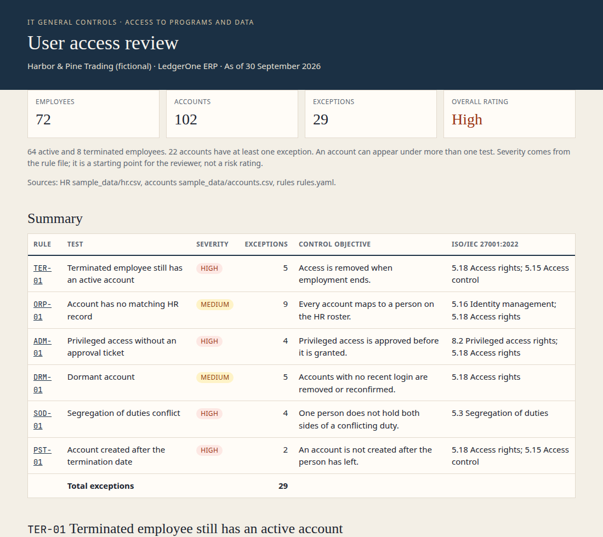

# itgc-access-review

A small Python tool that prepares an IT general controls (ITGC) user access review. It joins an HR roster to an application account export and lists the exceptions an IT auditor would otherwise build by hand in a spreadsheet.

Quarterly access reviews are usually a manual exercise. Someone exports the active users, someone else exports HR, and a reviewer looks for leavers who can still sign in, accounts with no owner, admins without an approval, unused accounts, and conflicting roles. This project automates that comparison for one system and writes the workpaper.

The company in the sample, Harbor & Pine Trading, is fictional. The names are made up. Nothing here is a real client or a real person.

## Control mapping

Every test sits in the ITGC domain **Access to programs and data**: who can use the system, whether that access was approved, and whether it is removed when the reason for it ends. Segregation of duties is tested here because the conflict shows up as two incompatible roles on one account.

The ISO references are Annex A of ISO/IEC 27001:2022.

| Rule | What it tests | Control objective | ISO/IEC 27001:2022 |
| --- | --- | --- | --- |
| TER-01 | Terminated employee still has an active account | Access is removed when employment ends. | 5.18 Access rights; 5.15 Access control |
| ORP-01 | Account has no matching HR record | Every account maps to a person on the HR roster. | 5.16 Identity management; 5.18 Access rights |
| ADM-01 | Privileged access without an approval ticket | Privileged access is approved before it is granted. | 8.2 Privileged access rights; 5.18 Access rights |
| DRM-01 | No login for more than N days (default 90) | Accounts with no recent login are removed or reconfirmed. | 5.18 Access rights |
| SOD-01 | Same user holds both roles in a conflict pair | One person does not hold both sides of a conflicting duty. | 5.3 Segregation of duties |
| PST-01 | Account created after the termination date | An account is not created after the person has left. | 5.18 Access rights; 5.15 Access control |

Severity (High, Medium, or Low) is set in `rules.yaml`. The overall rating is the highest severity among the exceptions. If there are none, the rating is Satisfactory. That rating is a starting point for the reviewer, not a risk assessment.

An account can fail more than one test. Helen Cho in the sample is a leaver, her account was created after she left, and it has never been used, so she appears under TER-01, PST-01, and DRM-01. Counts are exceptions, not distinct accounts.

## How to run

Python 3.11 or newer.

```bash
python3 -m venv .venv
source .venv/bin/activate   # Windows: .venv\Scripts\activate
pip install -r requirements.txt
python -m access_review --hr sample_data/hr.csv --accounts sample_data/accounts.csv --rules rules.yaml --out reports/sample/
pytest
```

`--out` is a folder. The command writes `itgc_access_review.xlsx` and `itgc_access_review.html` into it, and prints a short summary. The run exits 0 when the review finishes, including when it finds exceptions. An exception is a result, not a crash. A missing file or a broken rule exits 1.

`rules.yaml` holds the review date, the wording, the severity, the dormant window (`inactive_days`, default 90), and the segregation pairs. Dormant days are counted back from `review_date`, not from today, so the same files produce the same exceptions later. A login exactly 90 days before the review date still passes. A new account with no login yet is not dormant until the account itself is older than the window.

Set `enabled: false` to leave a test out. A skipped test is not a pass; say why in the workpaper.

### Input files

`sample_data/hr.csv`

| Column | Notes |
| --- | --- |
| employee_id | Required, unique |
| name | Required |
| department | |
| status | `active` or `terminated` (case is ignored) |
| termination_date | `YYYY-MM-DD`, blank if not terminated |
| manager | |

`sample_data/accounts.csv`

| Column | Notes |
| --- | --- |
| username | Required, unique |
| employee_id | Blank if the account has no owner |
| roles | One or more roles, separated by semicolons. A header named `role(s)` is also accepted. |
| is_admin | `TRUE` or `FALSE`. This is what "privileged" means in ADM-01. |
| last_login | `YYYY-MM-DD`, blank if the account has never logged in |
| created_date | `YYYY-MM-DD` |
| approval_ticket | Blank when there is no ticket id |

Every row in the account export is treated as an active account. The tool does not see a separate list of disabled users.

Regenerate the fictional population with:

```bash
python scripts/generate_sample_data.py
```

## Sample output

Review date 30 September 2026. Population: 72 employees (64 active, 8 terminated) and 102 accounts.

```text
ITGC user access review
Harbor & Pine Trading (fictional) - LedgerOne ERP
Review date: 2026-09-30
Population: 72 employees (64 active, 8 terminated), 102 accounts

Rule     Severity   Count  Control objective
----     --------   -----  ------------------
TER-01   High           5  Access is removed when employment ends.
ORP-01   Medium         9  Every account maps to a person on the HR roster.
ADM-01   High           4  Privileged access is approved before it is granted.
DRM-01   Medium         5  Accounts with no recent login are removed or reconfirmed.
SOD-01   High           4  One person does not hold both sides of a conflicting duty.
PST-01   High           2  An account is not created after the person has left.

Exceptions: 29 across 22 accounts (an account can fail more than one test)
Overall rating: High
Excel: reports/sample/itgc_access_review.xlsx
HTML:  reports/sample/itgc_access_review.html
```

| Rule | Severity | Exceptions | Control objective | ISO/IEC 27001:2022 |
| --- | --- | ---: | --- | --- |
| TER-01 | High | 5 | Access is removed when employment ends. | 5.18 Access rights; 5.15 Access control |
| ORP-01 | Medium | 9 | Every account maps to a person on the HR roster. | 5.16 Identity management; 5.18 Access rights |
| ADM-01 | High | 4 | Privileged access is approved before it is granted. | 8.2 Privileged access rights; 5.18 Access rights |
| DRM-01 | Medium | 5 | Accounts with no recent login are removed or reconfirmed. | 5.18 Access rights |
| SOD-01 | High | 4 | One person does not hold both sides of a conflicting duty. | 5.3 Segregation of duties |
| PST-01 | High | 2 | An account is not created after the person has left. | 5.18 Access rights; 5.15 Access control |
| **Total** | | **29** | 22 accounts. Overall rating **High**. | |



The Excel file has a Summary sheet and one sheet per rule. The HTML file is a single page with the same summary and one card per exception, including the evidence fields and a suggested remediation. Both files in `reports/sample/` were produced by the command above.

The sample is built so a few controls are operating as well as failing:

- Three leavers (Samuel Adeyemi, Nora Feldman, Chris Dalton) have no account left.
- Wei Chen, Hannah Berg, and Patrick Olsen are admins with an approval ticket. Ruth Okonkwo and Carmen Fernandez are admins without one.
- `svc_payroll` has no HR record, but it does have a ticket, so it is an orphan and not an unapproved admin.
- Ben Cho can create payments and Sara Lind can approve them. Grace Ibarra can do both.
- Mina Park joined on 1 September 2026 and has never logged in. That is inside 90 days, so the dormant test does not flag her.

## Limitations

- Matching is exact on `employee_id`. A different spelling, a contractor coded under a vendor id, or a rehire with a new id becomes an orphan. Name matching is not attempted.
- ADM-01 checks that a ticket id is present. It cannot tell whether the ticket was approved, or approved by the right owner. The text `n/a` would count as present.
- The dormant test does not know about leave of absence, service accounts that are supposed to be quiet, or the difference between an interactive logon and a batch logon. There is no whitelist. An account with no owner is an orphan on purpose.
- Segregation of duties is a list of pairs. It does not understand role hierarchies, emergency access, or compensating controls.
- PST-01 trusts the current HR status. An active rehire who still has an old termination date is not flagged.
- There is no sign-off workflow, no prior-quarter comparison, and no sampling. The output is the exception list a reviewer would follow up, not the finished audit opinion.
- One system, one review date, no time zones.

## What I learned

I built this project with an AI coding assistant, then ran the review and read through every exception myself to make sure I could explain it the way an IT auditor would.

- **One account, several failures.** Helen Cho shows up under TER-01, PST-01 and DRM-01 at the same time. Counting exceptions isn't the same as counting accounts, so the summary has to say both (29 exceptions across 22 accounts).
- **Classifying an exception correctly matters.** `svc_payroll` has no HR owner but does have an approval ticket. It's an orphan account (ORP-01), not an unapproved admin, and those two findings call for different remediations.
- **A passing test isn't proof the control works.** ADM-01 only checks that a ticket ID exists. It can't tell whether the right person approved it. Before using this on a real, anonymised population, I'd add a ticket-approver check and a whitelist for service accounts in `rules.yaml`.
- **Control mapping.** I now feel confident mapping segregation of duties to ISO/IEC 27001:2022 Annex A 5.3 and joiner–mover–leaver issues to 5.18. Handling client personal data in my part-time role as a licensed insurance agent showed me why access rights need to end when the reason for them ends.

## Layout

```text
access_review/          load the files, run the six tests, write the reports
rules.yaml              wording, severity, dormant days, conflict pairs
sample_data/            fictional HR roster and account export
scripts/generate_sample_data.py
reports/sample/         Excel and HTML from the sample run
tests/                  one test module per concern, including every rule
```

License: MIT. See `LICENSE`.
